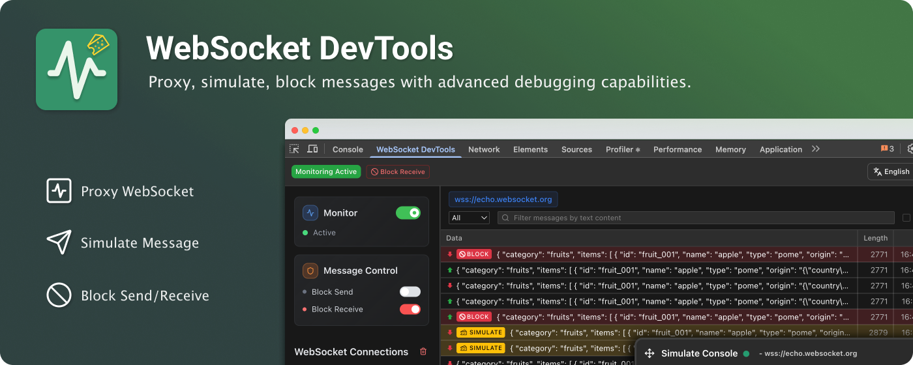
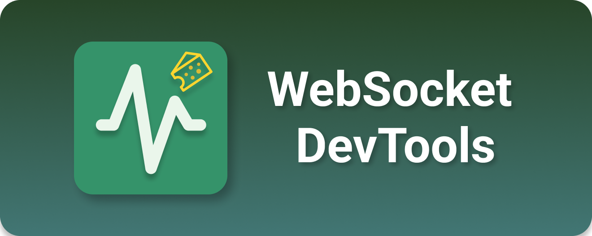
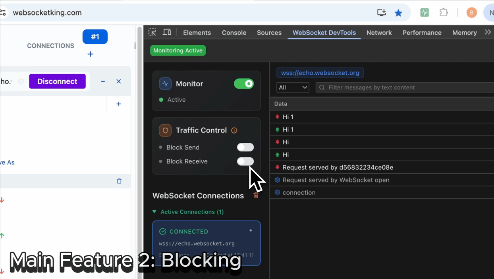
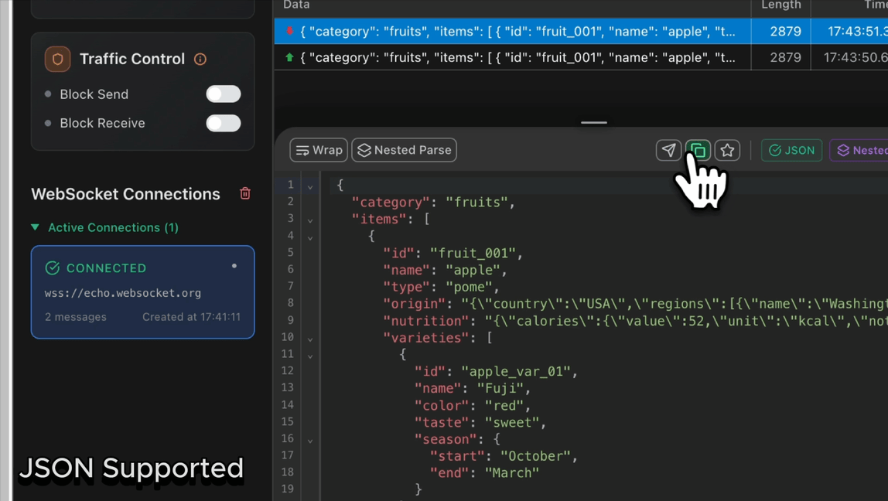
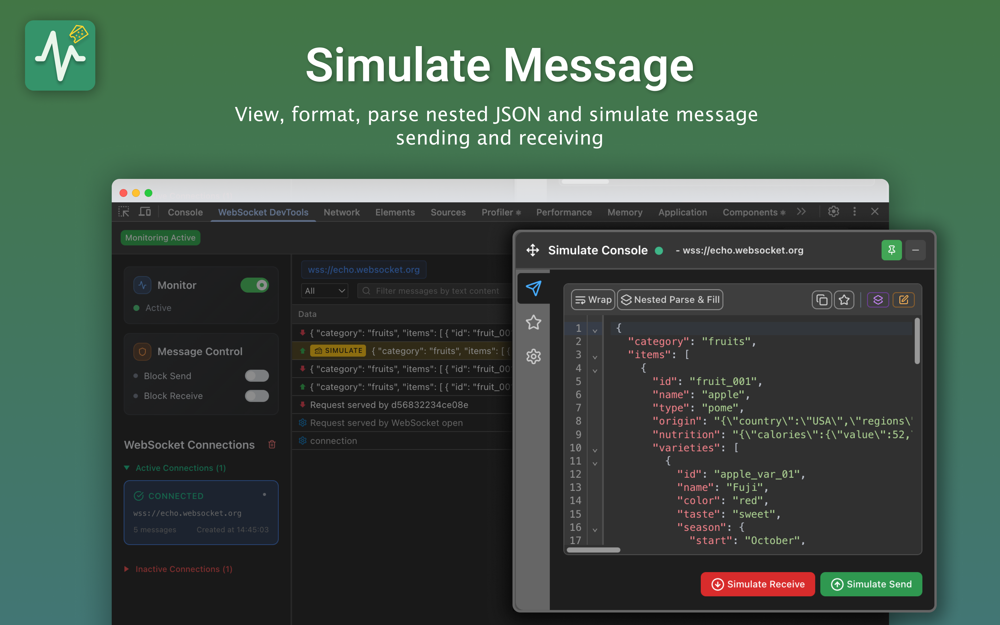
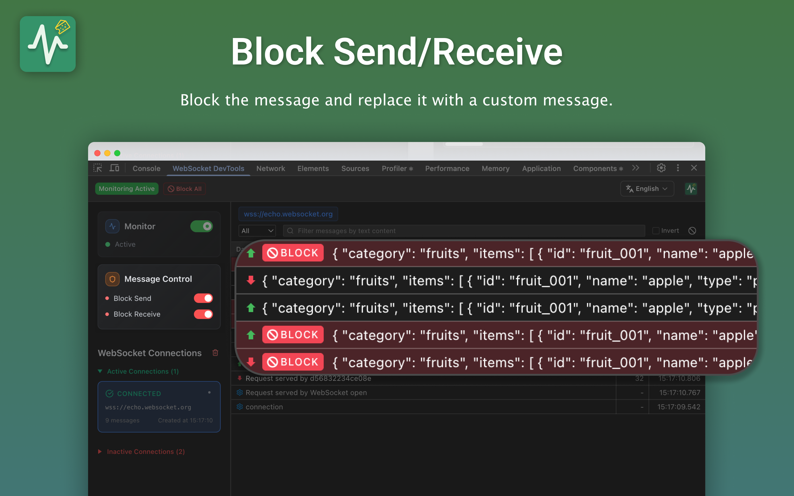
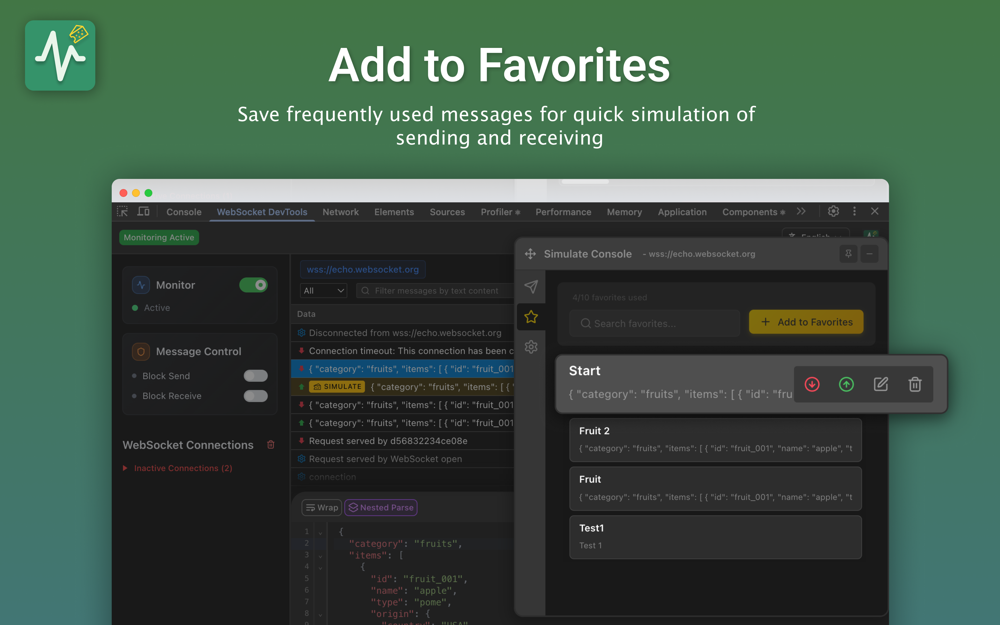
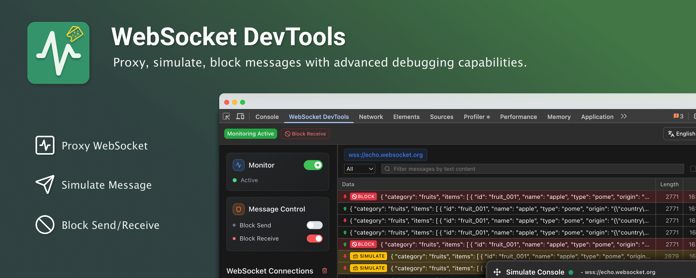

# WebSocket DevTools Enhanced

Community enhancements based on **WebSocket DevTools** by **Brian Luo / law-chain-hot**. This repository contains a modified version of the upstream project; it is not an official upstream release.

[简体中文说明](./README_zh-CN.md)

## Support the original project

The original author created the extension and its monitoring, simulation, interception, favorites, and DevTools integration. Please visit, star, and support the original project:

- Original repository: **[law-chain-hot/websocket-devtools](https://github.com/law-chain-hot/websocket-devtools)**
- Official website: **[www.websocket-devtools.com](https://www.websocket-devtools.com/)**

**推荐大家支持原版。这个版本基于原作者的优秀工作，主要补充二进制消息查看、解析和 JSON 可读性方面的功能。**

## What this version adds

| Area | Enhancements |
| --- | --- |
| Binary messages | Hex dump with offsets and ASCII, UTF-8, Base64, raw Hex, captured byte counts, and binary downloads. Blob, ArrayBuffer, and typed-array payloads survive Chrome extension messaging. |
| Global presentation | One selector controls message previews, details, and the JSON used for grouping. Search also matches decoded UTF-8 and protocol envelopes. |
| Smart formatting | Extract JSON objects or arrays following binary protocol headers; expand nested JSON strings. Support relaxed JSON syntax such as comments, single quotes, unquoted keys, and trailing commas. |
| Custom extraction | Skip a byte prefix and extract between literal start/end markers. Keep protocol prefixes/suffixes available separately without modifying captured bytes. |
| JSON tables | Switch between code and tables. Preview nested values, click into a new level, return through breadcrumbs, search the current level, and paginate large arrays. |
| Interface | Compact binary controls and translated editor search controls, including Chinese, while retaining the existing simulation, copy, favorites, wrap, and search tools. |

Binary previews retain up to **100 KB per message**. Larger captures are marked as truncated, and downloads contain only the captured preview. Smart formatting helps inspect JSON-like payloads; it does not automatically understand every proprietary binary protocol.

## Build and install this enhanced version

Use Node.js **22.12 or newer** and pnpm **10**:

```sh
git clone https://github.com/Along-me/websocket-devtools-enhanced.git
cd websocket-devtools-enhanced
pnpm install --frozen-lockfile
pnpm test
pnpm i18n
pnpm exec vite build
```

In Chrome (`chrome://extensions`) or Edge (`edge://extensions`), enable developer mode and load the generated `dist/` directory as an unpacked extension. After rebuilding, reload the extension, reopen DevTools, and refresh the inspected page.

For binary protocol messages containing JSON, select **UTF-8 smart format** at the top of the message list. Leave extraction rules blank to try automatic extraction. Use **Table** in the detail toolbar to explore JSON by level.

On Windows, package the built extension with PowerShell:

```powershell
Compress-Archive -Path ".\dist\*" -DestinationPath ".\websocket-devtools-enhanced.zip"
```

## License and attribution

The original MIT license and Brian Luo's copyright notice are preserved in [LICENSE](./LICENSE). Original documentation and assets are retained below. The upstream store listings and upstream release links refer to the **original version**, which does not necessarily include this repository's enhancements.

---

## Original project documentation

<div align="center">

</div>

<div align="center">

<!--  -->


# WebSocket DevTools

<a href="https://trendshift.io/repositories/20987?utm_source=trendshift-badge&amp;utm_medium=badge&amp;utm_campaign=badge-trendshift-20987" target="_blank" rel="noopener noreferrer"></a>

Complete WebSocket Traffic Control with advanced proxy, simulation, and blocking capabilities


[![][version-shield]][version-link]
[![][license-shield]][license-link]
[![][privacy-shield]][privacy-link]
[![][homepage-shield]][homepage-link]
[![][chrome-shield]][chrome-link]
[![][edge-shield]][edge-link]
[![][deepwiki-shield]][deepwiki-link]
[![][youtube-shield]][youtube-link]
[![][stars-shield]][stars-link]


**English** | [简体中文](./README_zh-CN.md) | [繁體中文](./README_zh-TW.md) | [日本語](./README_ja.md)

</div>


## 🚀 Installation

### Chrome Web Store
1. Visit [Chrome Web Store](https://chromewebstore.google.com/detail/websocket-devtools/fmnaobbfmjaaaebelkacpmmmpaaefbod)
2. Click **"Add to Chrome"** and confirm installation
3. Open DevTools (F12) → **"WebSocket DevTools"** tab

### Microsoft Edge
1. Visit [Microsoft Edge Add-ons](https://microsoftedge.microsoft.com/addons/detail/websocket-devtools/idkoddoekbiekjkpfjeadehmknaoppol)
2. Click **"Get"** and confirm installation
3. Open DevTools (F12) → **"WebSocket DevTools"** tab

### Manual installation from GitHub
1. Download the ZIP attached to the [latest GitHub Release](https://github.com/law-chain-hot/websocket-devtools/releases/latest)
2. Extract the ZIP
3. Open `chrome://extensions` or `edge://extensions`
4. Enable **Developer mode**, choose **Load unpacked**, and select the extracted folder

> Manual installations do not update automatically. Check the Releases page for newer versions.

### Homepage

- 🌐 [WebSocket DevTools](https://websocket-devtools.com) - Official website with documentation and demos 
- 📺 [YouTube Video](https://www.youtube.com/watch?v=L64x__1xORQ) - Demo video

## Star History

[](https://star-history.dera.page/#law-chain-hot/websocket-devtools&Date)

## ✨ Key Features

- **🔄 Background Monitoring** - Continuously monitor connections even when DevTools panel is closed
- **🎮 Message Simulation** - Send custom messages in both directions (Client ↔ Server)  
- **🚧 Traffic Control** - Block messages and simulate network issues for testing
- **💾 Favorites System** - Save and organize frequently used messages
- **🎨 DevTools Integration** - Native Chrome DevTools panel experience
- **🖼️ Iframe Support** - Full WebSocket proxy support for iframe embedded connections


## 🎬 Quick Demo

### Blocking




### Simulation


**Key Features Demonstrated:**
- **Message Blocking**: Intercept and block WebSocket messages in real-time
- **Message Simulation**: Send custom messages to test different scenarios
- **Traffic Control**: Manage WebSocket traffic flow for debugging
- **JSON Support**: Full JSON parsing and formatting capabilities


## 📷 Screenshots

<div align="center">


### Message Details & JSON Viewer


### Message Simulation & Traffic Control


### Smart Favorites System


</div>


## 📖 Quick Start

1. **Install Extension** - Add to Chrome and enable background monitoring
2. **Open DevTools** (F12) → Find **"WebSocket DevTools"** tab
3. **View Captured Data** - All WebSocket connections are automatically captured in background
4. **Inspect Messages** - Click connections to view message history  
5. **Simulate Messages** - Use Simulate tab with JSON editor
6. **Save Favorites** - Star frequently used messages for quick access

> **💡 Pro Tip**: The extension monitors WebSocket connections in the background, so you won't miss any connections even if you open DevTools after the WebSocket is established!

## 🔒 Privacy & Security

- ✅ **No data collection** - Everything stays in your browser
- ✅ **Local storage only** - No external servers or tracking
- ✅ **Open source** - Fully transparent and auditable code
- ✅ **Minimal permissions** - Only what's needed for functionality

## 🤝 Contributing & Support

- Read [CONTRIBUTING.md](./CONTRIBUTING.md) before opening a pull request
- Use [GitHub Issues](https://github.com/law-chain-hot/websocket-devtools/issues/new/choose) for bugs and feature requests
- Follow [SECURITY.md](./SECURITY.md) to report a vulnerability privately

---



---

<div align="center">

**MIT License** • [⭐ GitHub](https://github.com/law-chain-hot/websocket-devtools) • [📖 Wiki](https://github.com/law-chain-hot/websocket-devtools/wiki) • [📚 DeepWiki](https://deepwiki.com/law-chain-hot/websocket-devtools) • [🛒 Chrome Store](https://chromewebstore.google.com/detail/websocket-devtools/fmnaobbfmjaaaebelkacpmmmpaaefbod) • [📺 YouTube](https://www.youtube.com/watch?v=L64x__1xORQ)

</div> 

[version-shield]: https://img.shields.io/badge/version-1.4.0-55b467?labelColor=black&logo=github&style=flat-square
[license-shield]: https://img.shields.io/badge/license-MIT-369eff?labelColor=black&logo=opensourceinitiative&style=flat-square
[chrome-shield]: https://img.shields.io/badge/Chrome%20Web%20Store-Install-ffcb47?labelColor=black&logo=googlechrome&logoColor=white&style=flat-square
[privacy-shield]: https://img.shields.io/badge/privacy-local%20only-c4f042?labelColor=black&logo=shield-check&style=flat-square
[homepage-shield]: https://img.shields.io/badge/Homepage-WebSocket%20DevTools-blue?labelColor=black&logo=globe&style=flat-square
[websocket-shield]: https://img.shields.io/badge/WebSocket-DevTools-ff80eb?labelColor=black&logo=websocket&style=flat-square
[devtools-shield]: https://img.shields.io/badge/DevTools-Panel-8ae8ff?labelColor=black&logo=googlechrome&style=flat-square
[deepwiki-shield]: https://img.shields.io/badge/DeepWiki-Docs-orange?labelColor=black&logo=book&style=flat-square
[stars-shield]: https://img.shields.io/github/stars/law-chain-hot/websocket-devtools?color=ffcb47&labelColor=black&style=flat-square 
[version-link]: https://github.com/law-chain-hot/websocket-devtools/releases
[license-link]: ./LICENSE
[chrome-link]: https://chromewebstore.google.com/detail/websocket-devtools/fmnaobbfmjaaaebelkacpmmmpaaefbod
[privacy-link]: ./PRIVACY.md
[homepage-link]: https://websocket-devtools.com
[websocket-link]: https://github.com/law-chain-hot/websocket-devtools
[devtools-link]: https://chromewebstore.google.com/detail/websocket-devtools/fmnaobbfmjaaaebelkacpmmmpaaefbod
[deepwiki-link]: https://deepwiki.com/law-chain-hot/websocket-devtools
[stars-link]: https://github.com/law-chain-hot/websocket-devtools/stargazers
[youtube-shield]: https://img.shields.io/badge/YouTube-Video-red?labelColor=black&logo=youtube&style=flat-square
[youtube-link]: https://www.youtube.com/watch?v=L64x__1xORQ
[edge-shield]: https://img.shields.io/badge/Microsoft%20Edge-Install-0078d4?labelColor=black&style=flat-square
[edge-link]: https://microsoftedge.microsoft.com/addons/detail/websocket-devtools/idkoddoekbiekjkpfjeadehmknaoppol
