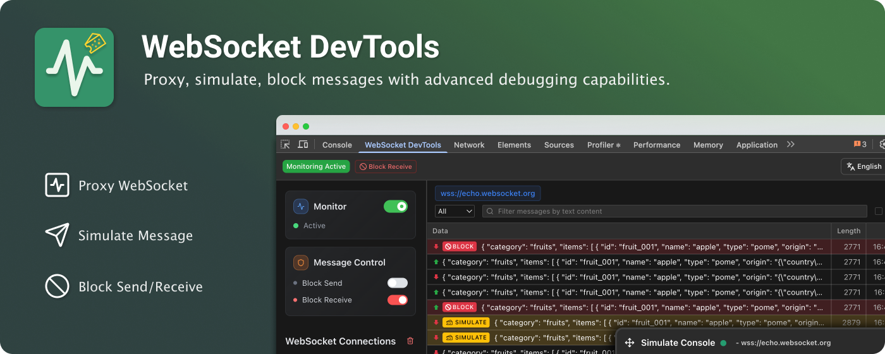
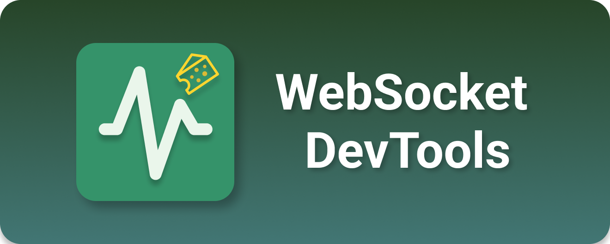
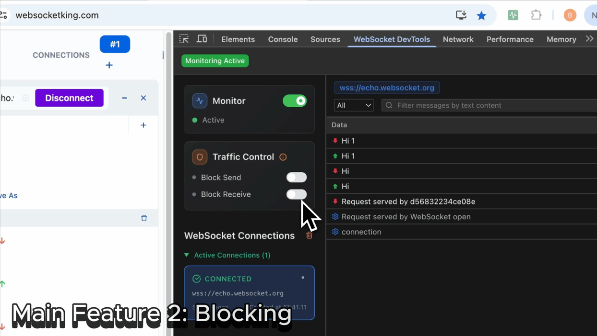
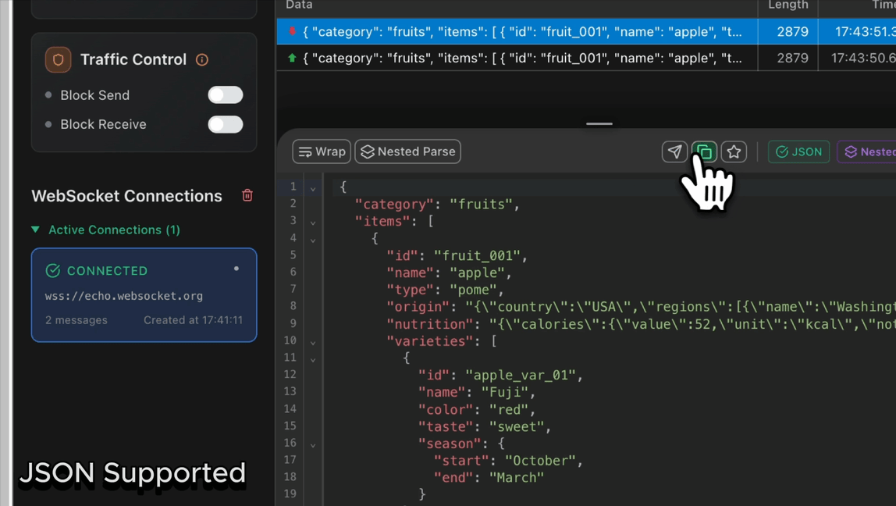
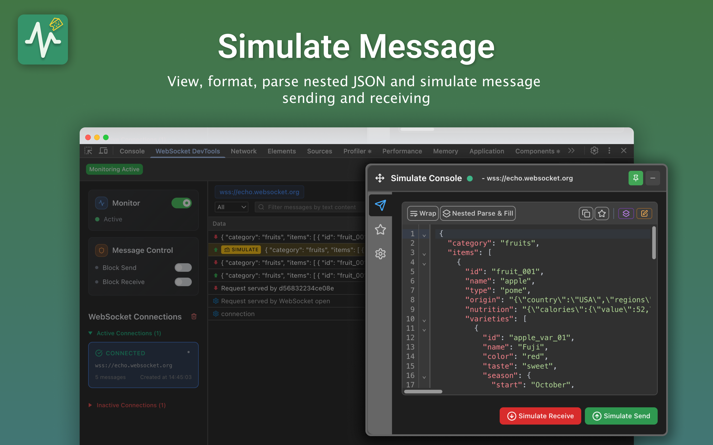
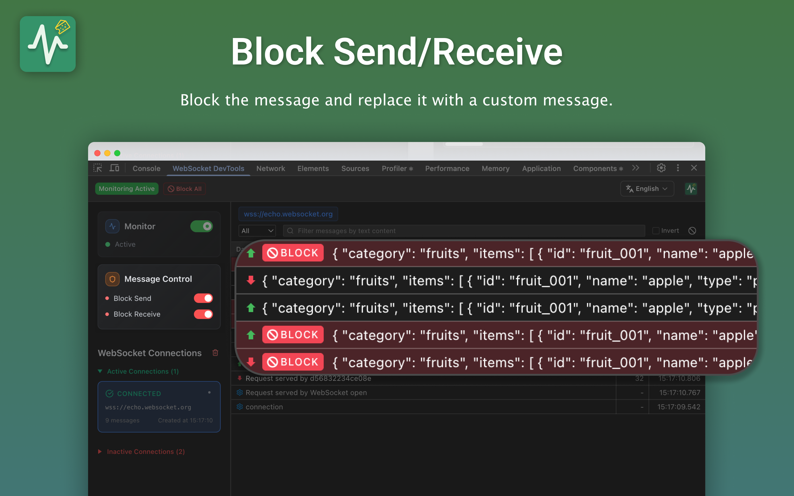
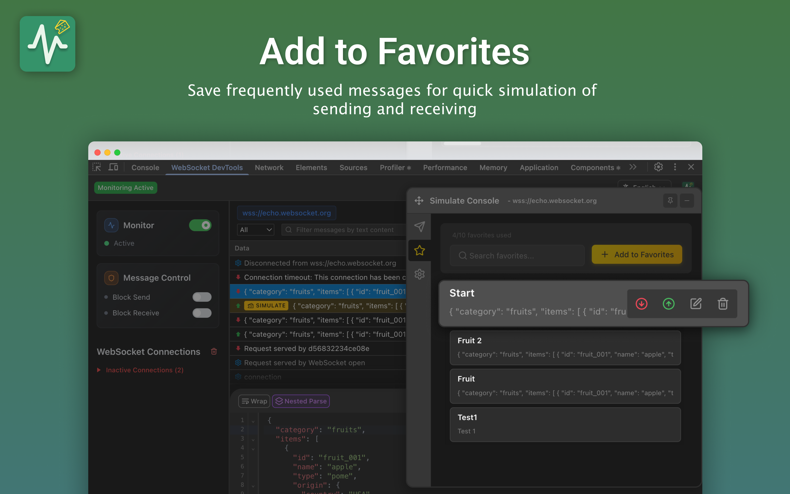
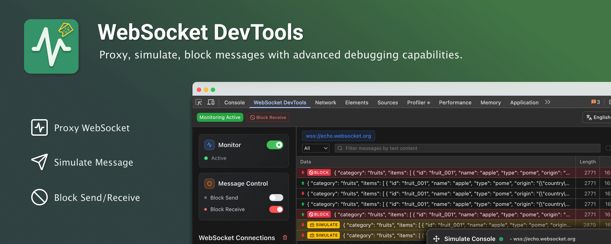

# WebSocket DevTools 增强版

基于 **Brian Luo / law-chain-hot** 开发的 **WebSocket DevTools** 进行的社区增强。本仓库是修改版，不是原作者的官方发布版本。

## 推荐大家支持原版

WebSocket 监控、消息模拟、流量拦截、收藏和 DevTools 集成等基础能力，均来自原作者的工作。欢迎大家优先了解原版，为原仓库点 Star，并支持原作者：

- 原版仓库：**[law-chain-hot/websocket-devtools](https://github.com/law-chain-hot/websocket-devtools)**
- 原版官网：**[www.websocket-devtools.com](https://www.websocket-devtools.com/)**

**感谢原作者提供这个优秀的开源工具。这个版本主要围绕二进制消息查看、解析和 JSON 可读性做补充。**

## 本版本新增了什么

| 方向 | 增强内容 |
| --- | --- |
| 二进制消息查看 | 支持带偏移量和 ASCII 的 Hex、UTF-8、Base64、原始 Hex，显示字节数并下载二进制数据；补充 Blob、ArrayBuffer、类型化数组经过扩展通信后的字节保留。 |
| 全局视图与搜索 | 顶部统一切换列表预览和详情的展示方式，分组读取同一套 JSON 结果；搜索也能匹配解码后的中文、UTF-8 文本和协议前后缀。 |
| 智能格式化 | 从“二进制协议头 + 路径/方法 + JSON”中提取对象或数组，展开嵌套 JSON 字符串；兼容注释、单引号、未加引号的键和尾逗号等宽松语法。 |
| 自定义提取规则 | 支持跳过前 N 字节、起始文本之后和结束文本之前的提取规则；协议前后缀可单独查看，原始捕获数据保持不变。 |
| JSON 表格 | 代码与表格切换；嵌套值显示摘要，点击进入下一层，用面包屑返回；支持当前层搜索和大数组分页。 |
| 界面体验 | 缩小二进制选择区域字号，补齐编辑器搜索栏的中文等语言翻译，保留模拟、复制、收藏、换行、搜索等原有工具。 |

二进制预览每条最多保留 **100 KB**。超过限制会标注截断，下载也仅包含已捕获的预览字节。智能格式化用于辅助查看含 JSON 的消息，不代表能够自动识别所有私有二进制协议。

## 构建并安装这个增强版

需要 Node.js **22.12 或更新版本**和 pnpm **10**：

```sh
git clone https://github.com/Along-me/websocket-devtools-enhanced.git
cd websocket-devtools-enhanced
pnpm install --frozen-lockfile
pnpm test
pnpm i18n
pnpm exec vite build
```

打开 Chrome 的 `chrome://extensions` 或 Edge 的 `edge://extensions`，开启开发者模式，点击“加载已解压的扩展程序”，选择构建生成的 `dist/` 文件夹。

重新构建后，在扩展管理页面重新加载插件，重开 F12，并刷新被调试网页。

查看包含 JSON 的二进制业务消息时，推荐将消息列表顶部的全局视图设为 **UTF-8 智能格式化**。自定义规则先留空，尝试自动识别。点击详情工具栏的“表格”可逐层查看 JSON。

Windows 下可用 PowerShell 打包构建结果：

```powershell
Compress-Archive -Path ".\dist\*" -DestinationPath ".\websocket-devtools-enhanced.zip"
```

## 授权与来源

保留原项目的 [MIT 许可证及 Brian Luo 的版权声明](./LICENSE)。下方保留原项目的文档和资源；其中的商店地址和原仓库 Release 链接指向**原版**，不代表包含本仓库新增的增强功能。

---

## 原项目文档

<div align="center">

</div>

<div align="center">

<!--  -->

## WebSocket DevTools

专业的WebSocket调试工具，提供实时监控、消息模拟和流量拦截功能


[![][version-shield]][version-link]
[![][license-shield]][license-link]
[![][privacy-shield]][privacy-link]
[![][homepage-shield]][homepage-link]
[![][chrome-shield]][chrome-link]
[![][edge-shield]][edge-link]
[![][stars-shield]][stars-link]
[![][deepwiki-shield]][deepwiki-link]
[![][youtube-shield]][youtube-link]


[English](./README.md) | **简体中文** | [繁體中文](./README_zh-TW.md) | [日本語](./README_ja.md)

</div>


## 🚀 安装

### Chrome 网上应用店
1. 访问 [Chrome 网上应用店](https://chromewebstore.google.com/detail/websocket-devtools/fmnaobbfmjaaaebelkacpmmmpaaefbod)
2. 点击 **"添加至 Chrome"** 并确认安装
3. 打开开发者工具 (F12) → **"WebSocket DevTools"** 标签页

### Microsoft Edge
1. 访问 [Microsoft Edge 加载项](https://microsoftedge.microsoft.com/addons/detail/websocket-devtools/idkoddoekbiekjkpfjeadehmknaoppol)
2. 点击 **"获取"** 并确认安装
3. 打开开发者工具 (F12) → **"WebSocket DevTools"** 标签页

### 从 GitHub 手动安装
1. 下载[最新 GitHub Release](https://github.com/law-chain-hot/websocket-devtools/releases/latest)中附带的 ZIP 文件
2. 解压 ZIP 文件
3. 打开 `chrome://extensions` 或 `edge://extensions`
4. 开启**开发者模式**，选择**加载已解压的扩展程序**，然后选中解压后的文件夹

> 手动安装不会自动更新，请通过 Releases 页面获取新版本。

### 官网

- 🌐 [WebSocket DevTools](https://websocket-devtools.com) - 官方网站
- 📺 [YouTube视频](https://www.youtube.com/watch?v=L64x__1xORQ) - 演示视频

## ✨ 核心功能

- **🔍 实时监控** - 实时跟踪WebSocket连接和消息更新
- **🔄 后台监控** - 即使关闭DevTools面板也能持续监控连接
- **🎮 消息模拟** - 双向发送自定义消息 (客户端 ↔ 服务器)
- **🚧 流量控制** - 拦截消息并模拟网络问题进行测试
- **💾 收藏系统** - 保存和组织常用消息
- **🌍 多语言支持** - 完整的英文和中文支持
- **🎨 DevTools集成** - 原生Chrome DevTools面板体验
- **🖼️ Iframe支持** - 完整的iframe嵌入式连接WebSocket代理支持

## 🎬 快速演示

### 消息拦截



### 消息模拟


**演示的核心功能:**
- **消息拦截**: 实时拦截和阻止WebSocket消息
- **消息模拟**: 发送自定义消息测试不同场景
- **流量控制**: 管理WebSocket流量进行调试
- **JSON支持**: 完整的JSON解析和格式化功能

## 📷 截图

<div align="center">


### 消息详情和JSON查看器


### 消息模拟和流量控制


### 收藏系统


</div>


## 📖 快速开始

1. **安装扩展** - 添加到Chrome并启用后台监控
2. **打开开发者工具** (F12) → 找到 **"WebSocket DevTools"** 标签页
3. **查看捕获数据** - 所有WebSocket连接都会在后台自动捕获
4. **检查消息** - 点击连接查看消息历史
5. **模拟消息** - 使用模拟标签页和JSON编辑器
6. **保存收藏** - 为常用消息添加星标以便快速访问

> **💡 专业提示**: 扩展在后台监控WebSocket连接，所以即使你在WebSocket建立后才打开DevTools，也不会错过任何连接！

## 🔒 隐私和安全

- ✅ **无数据收集** - 所有数据都保存在你的浏览器中
- ✅ **仅本地存储** - 无外部服务器或跟踪
- ✅ **开源代码** - 完全透明且可审计的代码
- ✅ **最小权限** - 仅请求功能所需的权限

## 🤝 贡献与支持

- 提交 Pull Request 前请先阅读 [CONTRIBUTING.md](./CONTRIBUTING.md)
- Bug 和功能建议请通过 [GitHub Issues](https://github.com/law-chain-hot/websocket-devtools/issues/new/choose) 提交
- 安全漏洞请按照 [SECURITY.md](./SECURITY.md) 私下报告

## 🛠 系统要求

- **Chrome 88+** 或基于Chromium的浏览器 (Edge, Brave等)
- **WebSocket API** - 兼容所有WebSocket实现
- 支持 **Socket.IO**、**ws库** 和自定义WebSocket解决方案

---



---

<div align="center">

**MIT许可证** • [⭐ GitHub](https://github.com/law-chain-hot/websocket-devtools) • [📖 Wiki](https://github.com/law-chain-hot/websocket-devtools/wiki) • [📚 DeepWiki](https://deepwiki.com/law-chain-hot/websocket-devtools) • [🛒 Chrome商店](https://chromewebstore.google.com/detail/websocket-devtools/fmnaobbfmjaaaebelkacpmmmpaaefbod) • [📺 YouTube](https://www.youtube.com/watch?v=L64x__1xORQ)

</div> 

[version-shield]: https://img.shields.io/badge/version-1.4.0-55b467?labelColor=black&logo=github&style=flat-square
[license-shield]: https://img.shields.io/badge/license-MIT-369eff?labelColor=black&logo=opensourceinitiative&style=flat-square
[chrome-shield]: https://img.shields.io/badge/Chrome%20Web%20Store-Install-ffcb47?labelColor=black&logo=googlechrome&logoColor=white&style=flat-square
[privacy-shield]: https://img.shields.io/badge/privacy-local%20only-c4f042?labelColor=black&logo=shield-check&style=flat-square
[homepage-shield]: https://img.shields.io/badge/Homepage-WebSocket%20DevTools-blue?labelColor=black&logo=globe&style=flat-square
[websocket-shield]: https://img.shields.io/badge/WebSocket-DevTools-ff80eb?labelColor=black&logo=websocket&style=flat-square
[devtools-shield]: https://img.shields.io/badge/DevTools-Panel-8ae8ff?labelColor=black&logo=googlechrome&style=flat-square
[deepwiki-shield]: https://img.shields.io/badge/DeepWiki-Docs-orange?labelColor=black&logo=book&style=flat-square
[stars-shield]: https://img.shields.io/github/stars/law-chain-hot/websocket-devtools?color=ffcb47&labelColor=black&style=flat-square 
[version-link]: https://github.com/law-chain-hot/websocket-devtools/releases
[license-link]: ./LICENSE
[chrome-link]: https://chromewebstore.google.com/detail/websocket-devtools/fmnaobbfmjaaaebelkacpmmmpaaefbod
[privacy-link]: ./PRIVACY.md
[homepage-link]: https://websocket-devtools.com
[websocket-link]: https://github.com/law-chain-hot/websocket-devtools
[devtools-link]: https://chromewebstore.google.com/detail/websocket-devtools/fmnaobbfmjaaaebelkacpmmmpaaefbod
[deepwiki-link]: https://deepwiki.com/law-chain-hot/websocket-devtools
[stars-link]: https://github.com/law-chain-hot/websocket-devtools/stargazers 
[youtube-shield]: https://img.shields.io/badge/YouTube-Video-red?labelColor=black&logo=youtube&style=flat-square
[youtube-link]: https://www.youtube.com/watch?v=L64x__1xORQ
[edge-shield]: https://img.shields.io/badge/Microsoft%20Edge-Install-0078d4?labelColor=black&style=flat-square
[edge-link]: https://microsoftedge.microsoft.com/addons/detail/websocket-devtools/idkoddoekbiekjkpfjeadehmknaoppol
